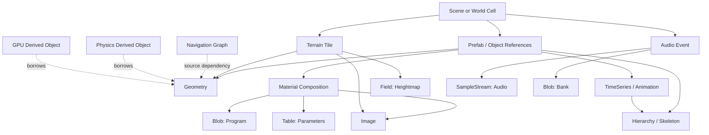
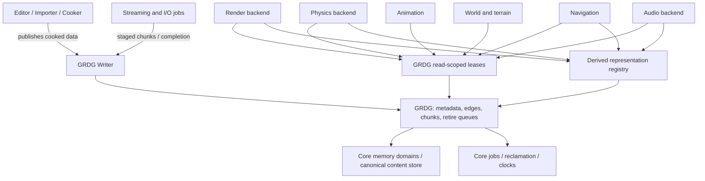

# SIREngine GRDG: resource type interfaces (review draft)

Status: PROPOSED INTERFACES. Declarations only; no GRDG implementation is claimed.
Repository baseline: SIGAAMDAD/SIREngine `develop`, d26167e104e6247d9cff028e8a75841718da5b64.
Review branch: architecture/grdg-resource-interfaces.

## Grounding

Current sources inspected (including updated `develop` terrain integration layout):
- Docs/Architecture/01-system-boundaries.md
- Docs/Architecture/02-memory-and-allocators.md
- Docs/Architecture/03-grdg.md
- Docs/Architecture/04-containers.md
- Docs/Architecture/07-editor-cooking-runtime.md
- Docs/Architecture/08-threading-and-jobs.md
- Docs/Architecture/13-migration-plan.md
- Docs/Milestones/04-GRDG.md
- Engine/Source/Runtime/Resources/README.md
- Docs/Standards/cpp.md

At this baseline GRDG and the typed resource API are not implemented. The accompanying .h files are interface declarations, not an implemented resource system. The C++17 syntax check compiles the headers, but no implementation or threading tests exist.

## Non-negotiable invariants

1. GRDG alone owns resource identity, dependency edges, canonical CPU payload allocation, revisions, residency and retirement. Resource subclasses and consumers never own a second canonical payload.
2. All base resource families are representation-oriented and system-agnostic. No dependency on renderer, RHI, physics backend, FMOD, script engine, gameplay or editor.
3. A specialized view is a non-owning, trivially small projection of a canonical GRDG payload; its class may add operations but no owned arrays, buffers, copies, or resource allocators. Current proposal: each view holds exactly two borrowed pointers, the read scope and immutable published record.
4. The logical resource key is stable across sessions; a process-local handle includes slot, generation and type and is never serialized as the identity.
5. Required dependency edges form a DAG (cycles rejected at cook/publication time). Optional and streamed references may form cycles but must never trigger unbounded recursive dependency resolution.
6. Immutable versions are published by one owner writer after validation. Readers acquire snapshots and use read-scoped views. Worker jobs and provider callbacks do not mutate published records.
7. Chunk storage is content-addressed and GRDG-deduplicated across keys where format and bytes are genuinely identical. Identical chunks are backed by one resident allocation. Hash collisions require payload comparison or rejection; hash equality alone never proves byte equality.
8. CPU canonical bytes may be read by multiple subsystems but may not be copied into independent CPU 'render mesh', 'collision mesh', 'audio bank' or 'navigation mesh' ownership caches. Truly derived representations (GPU device data, collision acceleration structures, decoded audio, etc.) are separately accounted for by the same resource ID/revision and only exist if required by a provider.
9. Eviction/reclamation requires reader quiescence and all provider pins, GPU fences, audio callbacks and physics jobs to finish. Raw bytes must never escape their scope or pin.
10. Partial load, allocation failure or validation error never publishes partial/mixed-version records. Failed staging allocations are returned to the staging domain; no external heap fallback hides budget failures.
11. GRDG runtime memory limits are configuration-driven, with per-domain attribution and high-water tracking; no game-specific fixed budget is embedded into public types.

### Representation hierarchy (C++ public view inheritance)

```mermaid
classDiagram
    SIRResourceView <|-- SIRBlobResourceView
    SIRResourceView <|-- SIRImageResourceView
    SIRResourceView <|-- SIRGeometryResourceView
    SIRResourceView <|-- SIRFieldResourceView
    SIRResourceView <|-- SIRTableResourceView
    SIRResourceView <|-- SIRGraphResourceView
    SIRResourceView <|-- SIRHierarchyResourceView
    SIRResourceView <|-- SIRTimeSeriesResourceView
    SIRResourceView <|-- SIRSampleStreamResourceView
    SIRResourceView <|-- SIRCompositionResourceView
    SIRBlobResourceView <|-- SIRTextResourceView
    SIRBlobResourceView <|-- SIRShaderResourceView
    SIRBlobResourceView <|-- SIRScriptResourceView
    SIRBlobResourceView <|-- SIRAudioBankResourceView
    SIRImageResourceView <|-- SIRRenderTextureView
    SIRGeometryResourceView <|-- SIRRenderMeshView
    SIRGeometryResourceView <|-- SIRCollisionMeshView
    SIRGeometryResourceView <|-- SIRNavigationGeometryView
    SIRGeometryResourceView <|-- SIRSkinnedMeshView
    SIRFieldResourceView <|-- SIRHeightFieldView
    SIRFieldResourceView <|-- SIRVolumeFieldView
    SIRHeightFieldView <|-- SIRTerrainHeightView
    SIRHeightFieldView <|-- SIRCollisionHeightView
    SIRTableResourceView <|-- SIRParameterSetView
    SIRParameterSetView <|-- SIRPhysicsMaterialView
    SIRGraphResourceView <|-- SIRNavigationGraphView
    SIRHierarchyResourceView <|-- SIRSkeletonView
    SIRTimeSeriesResourceView <|-- SIRAnimationClipView
    SIRSampleStreamResourceView <|-- SIRAudioClipView
    SIRCompositionResourceView <|-- SIRSceneView
    SIRCompositionResourceView <|-- SIRPrefabView
    SIRCompositionResourceView <|-- SIRWorldCellView
    SIRCompositionResourceView <|-- SIRTerrainTileView
    SIRCompositionResourceView <|-- SIRMaterialView
    SIRCompositionResourceView <|-- SIRAudioEventView
```



Terrain is a built-in runtime subsystem under `Engine/Source/Runtime/Terrain/`; terrain editing is under `Engine/Source/Editor/Terrain/`. Its mutable region state remains owned by Terrain, while immutable published asset payloads are owned by GRDG. If a region is mutable, Terrain must perform write transactions against exclusive unpublished/staging memory and publish updated revisions through GRDG; a shared published field cannot be mutated in place.

The branches do not represent new payload owners. Multiple different leaf views can be constructed from the same underlying canonical handle/revision if its data representation supports the required interpretation.

## Canonical resource families and interface surface

| Family | Canonical payload and semantics | Read API | Examples of derived views |
|---|---|---|---|
| Blob | Opaque immutable bytes, chunked by storage format | `getBytes` | Text, shader/program bytecode, scripts, FMOD bank |
| Image | Dimensions, encoding, mip/layer/plane addressing | `describeImage`, `getImagePlane` | Render texture |
| Geometry | Shared vertex streams, index streams, LODs and sections | `describeGeometry`, `getVertexStream`, `getIndexStream`, `getSubmesh` | Render mesh, collision mesh, nav geometry, skinned mesh |
| Field | Dense/sparse scalar or vector samples in 1D/2D/3D | `describeField`, `getFieldTile` | Terrain height, collision height, voxel/volume fields |
| Table | Typed schemas and columnar/record data | `describeTable`, `getColumn` | Parameter sets, physics materials, game database tables |
| Graph | Node/edge arrays with stable node identifiers | `describeGraph`, `getNodes`, `getEdges` | Navigation graph |
| Hierarchy | Parent indices and local transform hierarchy | `describeHierarchy`, `getParentIndices`, `getLocalTransforms` | Skeleton/rig |
| TimeSeries | Tick-indexed time/value track data | `describeTimeSeries`, `getTrack` | Animation clips, camera tracks, motion curves |
| SampleStream | Encoded or sampled frames with block addressing | `describeStream`, `getSampleBlock` | Audio clips, other sequential sampled signals |
| Composition | Typed dependency list and small cooked layout records | `getChild` | Scene, prefab, world cell, terrain tile, material, audio event |

Format identifiers and schema versions identify cook-time data layouts. They are not hard-wired to a graphics API, physics engine or mixer. Unknown formats fail explicitly; no implicit decode/copy on `get` operations.

### Source-level system specialization

- **Rendering:** `SIRRenderTextureView`, `SIRRenderMeshView`, `SIRMaterialView`, `SIRShaderResourceView`; canonical geometry, images, material references and source/bytecode are shared. GPU buffers/images/programs are registered as derived objects.
- **Physics:** `SIRCollisionMeshView`, `SIRCollisionHeightView`, `SIRPhysicsMaterialView`; read original vertex/index/height/parameter data; optional acceleration structures are tracked derived storage.
- **Navigation:** `SIRNavigationGeometryView`, `SIRNavigationGraphView`; read shared surfaces/graph arrays; provider navigation indices are tracked derived storage.
- **Terrain/world:** `SIRTerrainHeightView`, `SIRTerrainTileView`, `SIRWorldCellView`, `SIRSceneView`, `SIRPrefabView`; cells and tiles hold references to existing fields, images and geometry, never copied child payloads.
- **Animation:** `SIRSkinnedMeshView`, `SIRSkeletonView`, `SIRAnimationClipView`; geometry references a hierarchy resource, clips reference skeletons as needed; transient pose buffers are runtime working state, not duplicated asset storage.
- **Audio:** `SIRAudioClipView`, `SIRAudioBankResourceView`, `SIRAudioEventView`; FMOD bank memory can be lent by GRDG with a provider pin; FMOD internal derived state is separately traced.
- **Scripting/localization/data:** `SIRScriptResourceView`, `SIRTextResourceView`, `SIRTableResourceView`; no copies during read. Script execution state and other mutable runtime state live outside immutable resource payloads.

## Resource dependency graph (data edges, not C++ inheritance)



`Scene -> Material -> Image` is an actual logical dependency. `Physics Derived Object -> Geometry` and `GPU Derived Object -> Geometry` are provider-attachment relationships, never second CPU payload authority.

## Runtime and compile-time dependency graph



Allowed include direction: `Core <- Runtime/Resources <- Runtime consumers and providers`. The Resources public interfaces refer to Core types and opaque provider IDs, not backend implementation headers. Editor imports Core and Runtime interfaces; GRDG does not import Editor.

## Identity, chunks and deduplication

- `SIRResourceKey = (assetId:u64, typeId:u32, variantId:u32)` is the serializable cooked identity. `typeId` distinguishes concrete schema; `SIRResourceKind` distinguishes the ten canonical representation families.
- `SIRResourceHandle = (slot:u32, generation:u32, typeId:u32, reserved:u32)` is 16 bytes and process-local. Slot reuse always increments generation.
- `SIRResourceChunkId` addresses a logical chunk (mip, tile, LOD stream, audio frame block, etc.) within an asset.
- `SIRResourceContentKey` addresses physical shared chunk content by 128-bit digest, format and encoding. The content-store publication path checks byte identity and requirements before deduplicating.
- Multiple logical resource keys or subresources may reference the same physical chunk allocation. GRDG accounts that allocation once and retains it until the final logical user and all reader/provider pins are gone.
- `SIRResourcePublication` provides a list of chunks. Each entry either transfers a GRDG staging allocation or attaches an already resident identical chunk. No backend creates its own source-byte array.
- A new revision may temporarily coexist with an old one while existing readers finish. The old revision cannot be reclaimed early. This overlap is version retirement, not consumer-owned duplicate caches.

## Read and write access contracts

Typical read:

```cpp
sir::SIRResourceReadScope scope(graph);
sir::SIRResourceView raw;
if (graph.resolve(scope, meshHandle, &raw) == sir::SIRResourceResult::Success)
{
    sir::SIRRenderMeshView renderMesh(raw);
    sir::SIRCollisionMeshView collisionMesh(raw);
    // Both access identical canonical geometry bytes under the same scope.
}
```

The example is API intent. Calls to declaration-only interfaces do not link until implementations are supplied. Category and concrete layout validation is required before using specialized projections; a general geometry view does not guarantee that collision-friendly or render-friendly streams exist.

Typical publication:

1. Request the stable key and dependency closure through the writer; reject required cycles.
2. Allocate staging from GRDG, or attach an already resident content chunk.
3. Fill/validate unpublished staging bytes in producer jobs. A staging handle provides exclusive write access; no published reader sees this memory.
4. Submit a `SIRResourcePublication` with checked format, schema version, chunk identities and dependency edges.
5. One writer atomically publishes a complete immutable version (release); readers resolve with acquire semantics.
6. Retire the previous version after epochs and provider pins/fences complete. Bound collection work per frame.

A provider borrowing bytes across asynchronous GPU submission or an FMOD callback acquires a GRDG provider pin scoped to a specific revision. The provider releases its pin after the fence/callback. The provider cannot retain an unpinned pointer.

## File ownership (planned implementation)

- `Engine/Source/Runtime/Resources/Public/SIR/Resource/SIRResourceTypes.h`: keys, generations, states, chunks, typed edges, accounting.
- `Engine/Source/Runtime/Resources/Public/SIR/Resource/SIRResourceViews.h`: ten system-neutral read view families and scoped reader guard.
- `Engine/Source/Runtime/Resources/Public/SIR/Resource/SIRResourceGraph.h`: read access, writer capability, publication and provider representation accounting.
- `Engine/Source/Runtime/{Rendering,Physics,Audio,Animation,Navigation,World,Terrain}/Public/...`: subclass projections, split by consumer ownership in the implementation. The single combined `SIRSystemResourceViews.h` in this review package is a **draft convenience file**, not the proposed permanent common header.
- `Engine/Source/Runtime/Resources/Private/`: registry implementation, chunk content store, generation map, dependency validation, version publication, reclamation.
- `Engine/Source/Runtime/Resources/Tests/`: handle reuse, type validation, dedup, concurrency, fault injection, retirement and provider lifetime tests.

## Executable patch waves

| Patch | Ownership | Preconditions | Acceptance |
|---|---|---|---|
| R01 | Core Types + Resources | Foundation memory API available | C++17 declarations compile on Windows/Linux; 16-byte identity contracts, exhaustive enum validation |
| R02 | Resources | R01 | Generation-safe slot map, stable key lookup, per-chunk content dedup, traceable backing allocation |
| R03 | Resources | R02 | Writer publication / readers / epochs; TSan writer-reader stress, no reader sees partial version |
| R04 | Resources + Streaming | R03 | Chunk-level staging transfer, missing dependency/cycle and failure rollback tests; no duplicate source payloads |
| R05 | Resources | R03-R04 | Provider pins, derived accounting and fence-aware reclamation; forced callbacks/device-loss tests |
| R06 | Independent consumers | R01-R05 | Rendering/Physics/Navigation/Audio/Animation/Terrain read same canonical buffers; baseline equivalence and memory trace |
| R07 | Editor + persistence | R06 | Deterministic cooked IDs, reimport/hot reload, schema versions, scene round-trip |
| R08 | Integration | All | Full budget trace, duplicate-allocation detection, data races, long-lived streaming and shutdown plateau |

Parallelize R06 consumers only after R01-R05 public contracts are frozen. Keep Resources ownership exclusive to the integration owner; consumer workgroups own separate subsystem directories and cannot change the central Graph ABI in parallel.

## Verification matrix

| Invariant | Compile/static | Runtime / fault test |
|---|---|---|
| No derived view owns canonical memory | sizeof projections equals base view; forbid owning buffer members | Snapshot memory ledger shared across render, physics and nav readers |
| Stable keys, generation-safe handles | Type/layout assertions | Evict, reuse slot, resolve stale handle must fail |
| Single writer immutable publication | Writer API and thread assertions | TSan + many-readers/one-writer publication stress |
| Deduplicate identical chunks | Content key schema / no alias collision | Share chunk across distinct assets, count physical allocations once |
| No partial publication | Validated publish transaction | Inject I/O truncation, out-of-budget and invalid dependency |
| Lifetime-safe readers and providers | Read-scope API + pin handles | Evict while async GPU/FMOD/physics reader is active; reclamation delayed |
| No hidden CPU duplicates | Provider data members / allocator adapter checks | Domain allocation trace maps each resident chunk once |
| Editor/runtime round trip | Cooked schema versions | Reimport, hot reload, stream-in/out, platform cook consistency |

## Open implementation decisions

- Per-reader epoch slot storage and thread registration policy for thread migration and nested read scopes.
- Final structure and minimum resident format for typed per-chunk metadata (the skeleton above declares its accessors, but not the binary schema).
- Whether content-addressed collisions use bytewise comparison against resident data or fail closed during publication.
- Exact writer handoff protocol for worker-owned unpublished staging, including cancel/timeout and shutdown behavior.
- Provider pin implementation and corresponding source revision / resource handle validation under device-loss races.
- Format-specific ability to consume canonical bytes directly; GPU/physics/audio derived structures need provider accounting and a reasoned residency policy.

These are architectural decisions for implementation work, not capabilities claimed to exist in the current `develop` tree.
